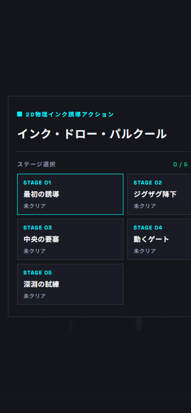

# インク・ドロー・パルクール (Ink Draw Parkour)

> マウスや指で描いたインクの軌跡がそのまま物理的な足場になる、2D物理インク誘導パルクールアクションゲーム

---

## 🎮 プレイ用URL

- **Web公開URL（Cloudflare Pages）**: [https://ink-draw-parkour.pages.dev](https://ink-draw-parkour.pages.dev)  
  *(スマートフォン・PCどちらのブラウザからでもインストール不要で即時プレイ可能です)*

---

## 📖 ゲーム概要と操作方法

### ゲーム概要
画面上部のドロップポータルから落下してくるボールを、画面上に描いたインクのライン（足場・スロープ）で受け止め、跳ね返し、転がしながら画面最下部のゴール枠へ導くパルクールアクションゲームです。  
描いた線は **生成から3.5秒で自然にフェードアウト・消滅** するため、素早い判断と流れるような線画スキルが求められます。

### 操作方法
- **インク描画**: 画面上を **マウスドラッグ** または **指でスワイプ**
- **インク残量**: 画面上部のゲージで管理。線を引くと消費し、引いていない間に自動回復
- **リセット / メニュー**: 画面右上の「設定」ボタンから即座にリトライまたはステージ選択へ移動
- **キーボードショートカット**: `R` キーでステージリセット、`Esc` キーで設定またはメインメニューへ遷移

---

## 🛠️ 使用技術

| カテゴリ | 使用技術・ツール | 用途・選定理由 |
| :--- | :--- | :--- |
| **フロントエンド** | HTML5 / CSS3 / JavaScript (ES6+) | 外部UIフレームワークに依存せず、軽量かつレスポンシブな高速描画を実現 |
| **レンダリング** | HTML5 Canvas API | 高フレームレート（60fps）で滑らかなベジェ曲線とベクター演出を描画 |
| **物理演算** | [Matter.js](https://brm.io/matter-js/) (2D Physics Engine) | 剛体シミュレーション、リアルタイム動的ボディ生成、衝突検知 |
| **オーディオ** | Web Audio API | 外部音声ファイルを使わず、オシレーター合成による軽量なシンセSEを実装 |
| **デプロイ・ホスティング** | Cloudflare Pages / Wrangler | 静的アセットのグローバル超高速エッジ配信、プレビュー環境の構築 |
| **開発環境** | Google Antigravity / Git / GitHub | エージェント駆動開発、ブランチ運用、コード設計・検証 |

---

## 💡 技術的なこだわり・工夫した点

### 1. リアルタイム・ストロークとMatter.js剛体の同期設計
- プレイヤーがドラッグした離散的な座標列から、二次ベジェ曲線（`quadraticCurveTo`）を用いて滑らかなインク描画を行いつつ、各線分に合わせた静的剛体（`Bodies.rectangle`）をリアルタイムにMatter.js物理ワールドへ追加しています。
- 各セグメントには生成タイムスタンプを持たせ、ライフタイム（3.5秒）を過ぎた瞬間に物理ワールドとCanvas描画の双方から破棄するクリーンアップパイプラインを構築しました。

### 2. 外部アセットゼロによる極限の軽量化 & Web Audio APIシンセサイザー
- 画像や音声（mp3/wav）などの外部ファイルを一切読み込まず、UIアイコン・アニメーション・パーティクル・サウンドすべてをコードベース（Canvas描画 & Web Audio API）で自己完結させています。
- 描画速度やインク残量に応じたピッチ変化（FM変調ライクな音響）、衝突速度に比例した打撃音、跳躍ブースト音をリアルタイムに波形合成し、軽量でありながら手応えのある「気持ちよさ（Juice）」を実現しました。

### 3. スマートフォンの操作性を第一にした垂直（縦画面）ゲームデザイン
- 当初はPC向けの横スクロール型として試作しましたが、モバイル端末で横画面を強制する体験はユーザーに負荷を与えるため、スマートフォンの持ち方に自然にフィットする「上から下への垂直落下・誘導型」へアーキテクチャを転換しました。
- `touch-action: none;` によるブラウザスクロール抑止、Retina / HiDPI対応のCanvas解像度自動補正、画面サイズに応じたレスポンシブ座標スケーリングを徹底しています。

---

## 🚀 開発中に直面した課題と解決プロセス

### 課題1: ポインターキャプチャによるUIイベント遮断バグ
- **問題**: インク描画を安定させるために Canvas 要素へ `setPointerCapture` を適用したところ、ゲームオーバーやクリア時にモーダルが開いた際、最前面の「もう一度（RETRY）」ボタンがクリックに反応しなくなる現象が発生。
- **原因の特定**: ゲーム状態が切り替わっても Canvas 側がポインターを排他占有し続けていたこと、および非表示状態の設定モーダル内のボタン要素が透明なままヒットテストを奪っていたことが判明。
- **解決策**: 
  1. 状態遷移時（`triggerGameOver` / `triggerStageClear`）および描画終了時に明示的に `releasePointerCapture` を呼び出す安全処理を追加。
  2. CSSにて非表示モーダル（`.overlay.hidden *`）に対し `visibility: hidden;` および `pointer-events: none !important;` を指定し、UI階層間のイベント競合を完全に解消しました。

### 課題2: 薄いインク足場をボールがすり抜ける現象（トンネリング）
- **問題**: ボールが高速で落下した際、描画したインクラインの厚み（8px）を飛び越えて貫通してしまう物理トンネリングが発生。
- **解決策**:
  - 重力加速度を縦スクロール誘導に適した値（`gravity.y = 0.45`）へ最適化。
  - ボールの最大速度（`maxSpeed`）を物理エンジンのステップ幅に応じた安全範囲にクランプし、物理セグメント両端に面取り（`chamfer`）を施すことで、薄い線でも確実に接触反発が得られるようチューニングしました。

### 課題3: 英語UIから日本語化時の不自然なテキスト改行
- **問題**: UIを日本語化した際、モバイル幅においてタイトルや見出しが単語の不自然な位置で折り返されてしまい、デザインの品位が低下。
- **解決策**:
  - 新機能・改修ブランチ（`fix/japanese-text-wrapping`）を切って作業を実施。
  - `word-break: keep-all;` と `overflow-wrap: break-word;` の組み合わせ、および重要ラベルへの `white-space: nowrap;` の適用により、文字泣き別れを防ぎつつ全デバイスで美しく収まるレイアウトを実現しました。

---

## 📜 開発履歴

日々の機能追加、設計判断、リファクタリングの詳細ログは [DEVLOG.md](DEVLOG.md) をご覧ください。
